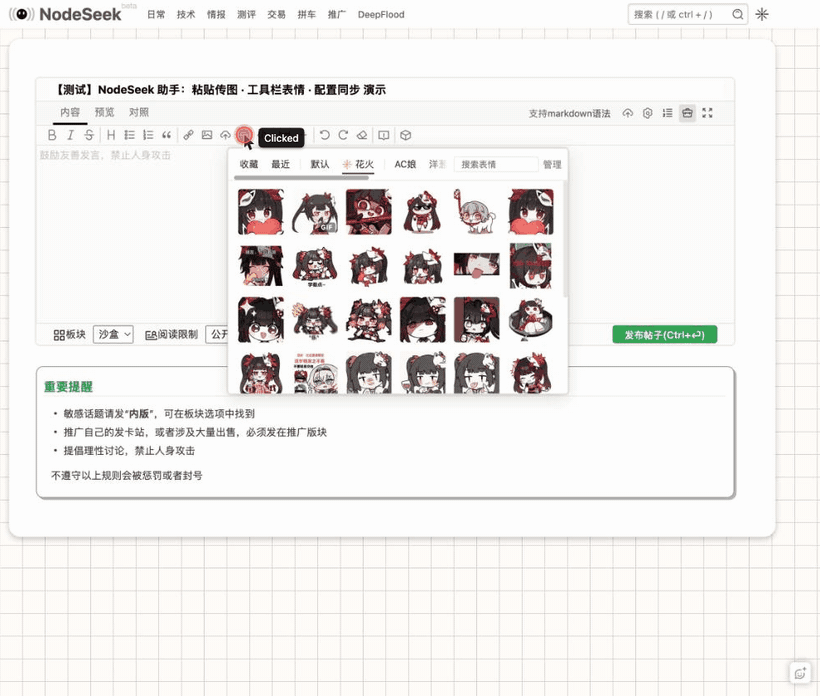
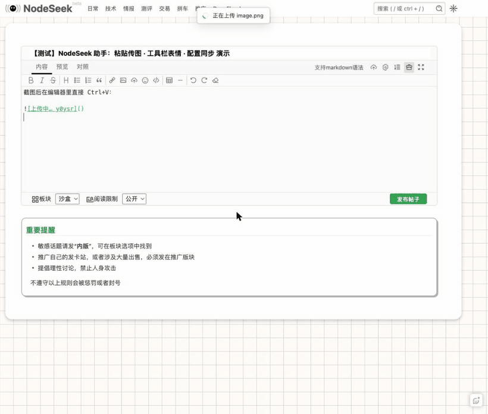
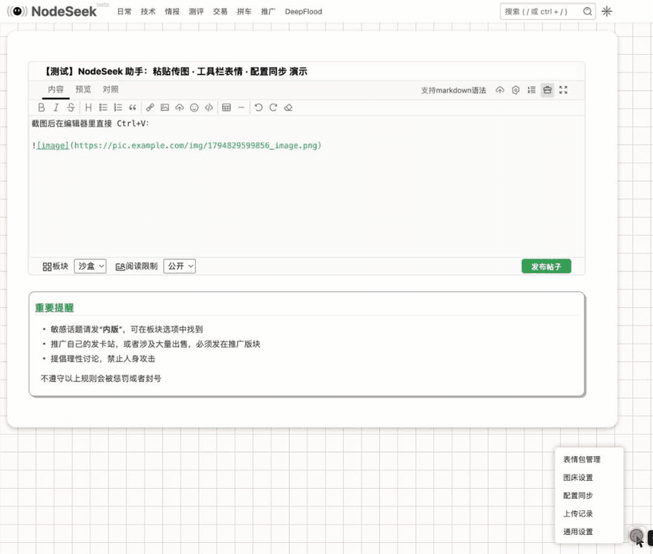

<div align="center">

# NodeSeek 助手

为 [NodeSeek](https://www.nodeseek.com) 打造的增强脚本：**粘贴即传图床 · 表情包管理与快捷发送 · 多端配置同步**。
界面直接复用论坛自身的样式变量，跟随日 / 夜间模式切换，看起来就像论坛原生功能。

同一份代码同时产出 **油猴脚本** 与 **Surge / Shadowrocket（小火箭）/ Quantumult X / Loon / Stash 模块**。

[安装](#安装) · [功能](#功能) · [图床](#支持的图床) · [配置同步](#配置同步) · [自建同步服务](#自建同步服务) · [开发](#开发)

</div>

---

| 工具栏表情：分组 · 悬浮播放 · 官方转义码 | 粘贴截图自动上传图床 |
|---|---|
|  |  |



## 安装

到 [Releases](https://github.com/genguzzz/nodeseek-helper/releases/latest) 下载，或直接使用下面的链接（总是指向最新版本）。

| 运行方式 | 安装 |
|---|---|
| **Tampermonkey / Violentmonkey**（推荐） | 安装 [`nodeseek-helper.user.js`](https://github.com/genguzzz/nodeseek-helper/releases/latest/download/nodeseek-helper.user.js)，脚本会自动检查更新 |
| **Surge** | 模块 → 安装新模块：`https://github.com/genguzzz/nodeseek-helper/releases/latest/download/nodeseek-helper.sgmodule` |
| **Shadowrocket（小火箭）** | 配置 → 模块 → 右上角 ＋，填入：`https://github.com/genguzzz/nodeseek-helper/releases/latest/download/nodeseek-helper.module`；并在「配置 → HTTPS 解密」里开启解密、安装并信任证书 |
| **Quantumult X** | 重写 → 引用：`https://github.com/genguzzz/nodeseek-helper/releases/latest/download/nodeseek-helper.snippet` |
| **Loon** | 插件：`https://github.com/genguzzz/nodeseek-helper/releases/latest/download/nodeseek-helper.plugin` |
| **Stash** | 覆写：`https://github.com/genguzzz/nodeseek-helper/releases/latest/download/nodeseek-helper.stoverride` |

> 想固定某个版本（或怀疑 `latest` 跳转被缓存）时，把地址里的 `latest/download` 换成 `download/v<版本号>`，如 `releases/download/v0.3.3/nodeseek-helper.sgmodule`。模块内的脚本地址始终指向它所属的版本，不会新旧混用。

> 代理版本需要开启 MITM 并信任证书，模块已声明 `nodeseek.com`、`deepflood.com` 两个域名。
> 代理版本运行在手机浏览器等任意环境中，无需安装扩展；配置保存在站点的本地存储里，可用「配置同步」或「配置导入 / 导出」与油猴版互通。

首次使用：打开任意帖子，点击右下角「回到顶部」上方的 **助手** 按钮 → 图床设置。

## 功能

### 图片上传
- 在回复 / 发帖编辑器里 **粘贴截图或图片**、**拖入图片文件**，自动上传并插入 Markdown；上传中先插入占位，完成后替换。
- 工具栏与编辑器右上角提供上传按钮（可在「通用 → 界面入口」关闭）。
- 可选上传前压缩：WebP / JPEG、质量、最大宽度。
- 上传记录：复制链接 / Markdown，一键设为表情。

### 表情包
- **并入编辑器底部原生表情栏**：「收藏 / 最近 / 自定义分组」排在 AC娘、洋葱头等官方分组之前，点开即在原生位置展开；最右侧是搜索与表情设置。与官方分组互斥展开，点官方表情同样计入「最近使用」。
- Markdown 工具栏的 **笑脸按钮** 也保留，弹出完整表情面板（桌面跟随页面原生滚动；手机端为底部抽屉，可下拉关闭）：收藏、最近使用、自定义分组、官方表情、搜索。
- 电脑上动图默认静止，**鼠标悬浮播放并显示大图预览**；手机上可见的动图直接播放、点选不弹预览（可在设置里关闭）；Shift + 点击可连续插入。
- 内置「花火」表情分组（来源 [NodeSeek 帖子](https://www.nodeseek.com/post-472759-1)）。
- 管理面板：分组新建 / 重命名 / 拖动排序 / 自定义图标（emoji、图片链接、SVG）、卡片拖动排序、拖到分组即移动、按使用次数 / 最近 / 名称排序、批量收藏 / 移动 / 删除、导出备份。
- 批量导入：粘贴链接、Markdown、HTML 或整段帖子（自动提取图片）、本地图片（经图床上传）、JSON 备份。
- 帖子中悬浮图片可 **一键收藏为表情**。

### 不消耗别人的图床流量
收藏或导入表情时：

| 图片来源 | 处理 |
|---|---|
| NodeSeek 官方图床（NodeImage）、论坛自身资源 | 直接收藏 |
| 你自己配置的图床 | 直接收藏 |
| 其他图床 | 提示后下载并 **转存到你的图床**；没有配置图床时引导转存到官方图床 NodeImage |

转存时体积偏大（> 200KB 或边长 > 360px）的表情会自动压缩：静态图转 WebP；GIF 逐帧缩放后重新编码，**保留动画与透明**。

### 界面
- 所有颜色取自论坛的 CSS 变量（`--main-color`、`--bg-main-color`…），日 / 夜间自动切换。
- 入口：右下角「助手」按钮、导航栏图标、编辑器右上角齿轮、油猴菜单，均可单独关闭。

## 支持的图床

| 图床 | 说明 |
|---|---|
| [CloudFlare-ImgBed](https://github.com/MarSeventh/CloudFlare-ImgBed)（Sanyue ImgHub） | 推荐。认证码或 API Token；渠道、目录、命名方式、自定义链接前缀；**「读取站点配置」一键填写** |
| [兰空图床 Lsky Pro](https://github.com/lsky-org/lsky-pro) | v1 / v2，储存策略、相册、权限 |
| [EasyImage 2.0](https://github.com/icret/EasyImages2.0) | Token |
| [Chevereto](https://chevereto.com) | V3 / V4 API Key，相册 |
| [NodeImage](https://www.nodeimage.com)（论坛官方图床） | API Key |
| [SM.MS](https://sm.ms) | Token，可切换国内域名 |
| [Imgur](https://imgur.com) | Client ID |
| [PicList / PicGo](https://piclist.cn) | 转发到本机 PicList，间接支持它的全部图床 |
| **自定义** | 请求地址、方法、请求头、表单字段、binary 请求体、返回值 JSON 路径、URL 前缀，适配任意 API |

可同时保存多套配置并随时切换，每套都能「测试上传」。

## 配置同步

在多台设备、油猴版与代理版之间同步 **图床配置、通用设置、全部表情包（含自定义分组与图标）**。

| 后端 | 适合 | 准备 |
|---|---|---|
| **自建同步服务** | 想要实时同步、数据完全自管 | 部署本项目的 Go 服务（见下节），粘贴服务端生成的**同步码**即可（也可切换为手动填写地址 + 令牌） |
| **WebDAV** | 坚果云、Nextcloud、群晖、Alist、InfiniCLOUD… | 目录地址 + 账号 + 密码（坚果云用「第三方应用密码」） |
| **GitHub Gist** | 有 GitHub 账号 | 只含 `gist` 权限的令牌；Gist ID 留空会自动创建私密 Gist |
| **OneDrive** | 微软账号 | 在 Microsoft Entra 注册应用（见下） |

- **端到端加密**：设置同步口令后，数据在本机用 AES-256-GCM 加密再上传，任何后端只看到密文；口令只保存在本机。
- **按条目合并**：多端同时修改不同的表情 / 分组 / 图床都会保留；同一条目以最后修改为准；使用次数取最大值；删除以墓碑记录。
- **自动同步**：修改后 1.5 秒推送；页面回到前台时拉取；可设定时拉取；自建服务通过长轮询实时推送。

### 同步码、加密口令与接入码

使用自建同步服务时会碰到三样东西，作用各不相同：

| | 是什么 | 从哪来 | 决定了 |
|---|---|---|---|
| **同步码**（`nsh1_…`） | 服务地址 + 访问令牌，编码成一串 | 服务端启动日志打印 | 数据存到**哪里**：同一个同步码的设备读写同一份云端数据 |
| **加密口令** | 你自己定的一句话（可留空） | 自己设定，只保存在本机，从不上传 | **谁能读懂**数据：云端只存密文，服务端也解不开 |
| **接入码**（同样 `nsh1_…` 开头） | 同步码 + 加密口令打包 | 已同步的设备「同步」页 →「复制接入码」 | 新设备粘贴一次，两样都填好 |

两者**相互独立、但都必须一致**：
- 同步码不同 → 设备各自同步到不同空间，互不影响。
- 同步码相同、口令不同 → 能连上服务，但解不开别人写的数据，状态显示「口令错误」，不会覆盖云端。
- 口令留空 → 不加密，数据只压缩后存到服务端。

**推荐用法**

1. 第一台设备：粘贴服务端日志里的同步码，在「加密口令」里设一个口令（也可不设），点「立即同步」。
2. 其他设备：在第一台设备上点「复制接入码」，粘贴到新设备的同步码输入框即可，口令自动带上。
3. 也可以手动在每台设备上粘贴同步码，再填写相同的口令。

**忘记了口令？** 口令不经过服务端，服务端也无法解密。在任意一台设备上填写新口令，状态为「口令错误」时点「忘记口令？重置云端」，用本机数据覆盖云端；其他设备再粘贴这台设备的接入码（或填新口令）即可。云端旧数据会被丢弃。
- 数据格式与协议见 [docs/sync.md](docs/sync.md)。

<details>
<summary>OneDrive 应用注册步骤</summary>

1. 打开 [Microsoft Entra 应用注册](https://entra.microsoft.com/#view/Microsoft_AAD_RegisteredApps/ApplicationsListBlade) → 新注册。
2. 受支持的账户类型选择「任何组织目录中的帐户和个人 Microsoft 帐户」，重定向 URI 留空。
3. 「身份验证」→ 高级设置 → **允许公共客户端流** 设为「是」。
4. 「API 权限」→ 添加 Microsoft Graph 委托权限 `Files.ReadWrite.AppFolder`、`offline_access`。
5. 复制「应用程序(客户端) ID」填入脚本，点「登录 OneDrive」，在打开的微软页面输入显示的代码（已自动复制）。

数据保存在 OneDrive 的「应用 / nodeseek-helper」专属文件夹中，脚本无权访问其他文件。
</details>

## 自建同步服务

`server/` 是一个只依赖 Go 标准库的单文件服务：**常驻内存 < 10MB**（CI 中有内存检查），数据以文件形式落盘，只保存加密后的信封，不解析内容。

### Docker

```bash
docker run -d --name nsh-sync --restart unless-stopped \
  -p 8787:8787 -v nsh-sync-data:/data \
  -e NSH_TOKENS=换成一个足够长的随机令牌 \
  ghcr.io/genguzzz/nodeseek-helper-sync:latest
```

### 二进制

从 [Releases](https://github.com/genguzzz/nodeseek-helper/releases/latest) 下载对应平台（Linux amd64 / arm64 / armv7、macOS、Windows、FreeBSD）：

```bash
NSH_TOKENS=换成一个足够长的随机令牌 NSH_DATA=./data ./nsh-sync-server
```

### 同步码

同步码把「对外访问地址 + 令牌」编码成一个 `nsh1_` 开头的字符串，客户端只需粘贴这一个值：

```bash
# 启动时设置对外访问地址，日志里会为每个令牌打印同步码
NSH_PUBLIC_URL=https://sync.example.com NSH_TOKENS=换成一个足够长的随机令牌 ./nsh-sync-server
# 或直接计算
./nsh-sync-server code https://sync.example.com 换成一个足够长的随机令牌
```

同步码只是编码混淆而非加密，持有它即可访问对应空间，请像密码一样保管；数据本身仍由客户端的同步口令端到端加密。

**新设备接入**：在已经同步好的设备上打开「同步」页点「复制接入码」，接入码 = 同步码 + 加密口令，在新设备的同步码输入框粘贴一次即可（不要把同步码填进「加密口令」框，口令需与其他设备一致）。

### 配置

| 环境变量 | 默认 | 说明 |
|---|---|---|
| `NSH_PUBLIC_URL` | — | 对外访问地址（如反代后的 HTTPS 地址），设置后启动日志打印同步码 |
| `NSH_TOKENS` | — | 允许的令牌，逗号分隔；每个令牌是一个独立空间（可分给朋友） |
| `NSH_OPEN` | — | 设为 `1` 时接受任意长度 ≥ 16 的令牌（开放注册） |
| `NSH_ADDR` | `:8787` | 监听地址 |
| `NSH_DATA` | `./data` | 数据目录 |
| `NSH_MAX_BODY` | `2097152` | 单个空间数据上限（字节） |
| `NSH_MAX_SPACES` | `1000` | 空间数量上限 |
| `NSH_MAX_WATCHERS` | `256` | 长轮询连接上限 |
| `NSH_LOG` | — | 设为 `quiet` 关闭请求日志 |

建议放在 HTTPS 反向代理之后（Caddy / Nginx）。令牌以 SHA-256 摘要作为空间 ID，服务端不保存明文令牌。

### 设计要点
- 乐观并发：`ETag` + `If-Match`，冲突返回 412，由客户端重新合并后推送。
- 写入流式落盘（边写边算 SHA-256，临时文件 + 原子重命名），读取直接流式返回，数据不驻留内存。
- `GET /v1/sync/watch` 长轮询：数据变化即刻唤醒等待中的设备，实现实时同步。
- 内存上限默认 8MiB（`GOMEMLIMIT`），按空间限流。

## 开发

```bash
npm install
npm run dev          # 启动本地 dev server（热更新）
npm run dev:install  # 自动把开发加载器安装进 Arc 的 Tampermonkey（只需一次，之后保存即生效）
npm run build        # 产出 dist/：油猴脚本 + 代理注入版 + 各代理工具模块
npm test             # 同步合并 / 加密单测
npm run typecheck
```

- 基于 [vite-plugin-monkey](https://github.com/lisonge/vite-plugin-monkey) + Vue 3 + TypeScript。
- 开发模式下，油猴里安装的只是加载器（`/nsh-dev.user.js`），代码从本地 dev server 动态加载并热更新；dev server 重启、配置变化都无需重装。详见 [docs/dev.md](docs/dev.md)。
- 代理版构建（`vite.inject.config.ts`）把 `$`（GM API）替换为 `src/platform/web.ts`：存储用 localStorage，跨域请求经同源 `/__nsh/relay` 交给代理脚本转发。
- 本地无登录态调试：`node dev/mock-server.mjs` 后打开
  - `http://localhost:5299/dev/mock.html`：模拟编辑器 + 模拟 ImgBed（认证码 `test-code`）
  - `http://localhost:5299/dev/proxied.html`：页面与 `/__nsh/*` 经真实的 `dist/nsh-proxy.js` 处理（`dev/proxy-sim.mjs` 模拟 Surge；`NSH_SIM=qx` 模拟 Quantumult X）。构建时设 `NSH_PUBLISH_BASE=http://localhost:5299/dist`。
- 个人图床配置可放在 `presets/*.json`（已 gitignore），在「通用 → 配置导入」中导入；其中的域名会在本地构建时写入 `@connect`，Tampermonkey 不再弹跨域确认。
- 自建服务：`cd server && go test ./... && bash scripts/memcheck.sh`。

### 目录

```
src/
  core/        编辑器注入、上传、图床定义、表情、收藏策略、压缩、存储
  sync/        同步：文档格式与合并、加密信封、各后端、自动同步引擎
  components/  面板与弹层（Vue）
  platform/    代理版的 GM API 适配
proxy/         代理通用脚本模板
server/        Go 自建同步服务
docs/          同步协议
```

### 发布

推送 `v*` 标签后，GitHub Actions 会构建全部产物（`user.js` / `inject.js` 均经 esbuild 压缩，不做混淆，避免拖慢加载与运行）（设置 `NSH_PUBLISH_BASE` 为 Release 下载地址）、多平台服务端二进制与多架构 Docker 镜像（`ghcr.io/genguzzz/nodeseek-helper-sync`），并创建 Release。

## 许可

[MIT](LICENSE)
